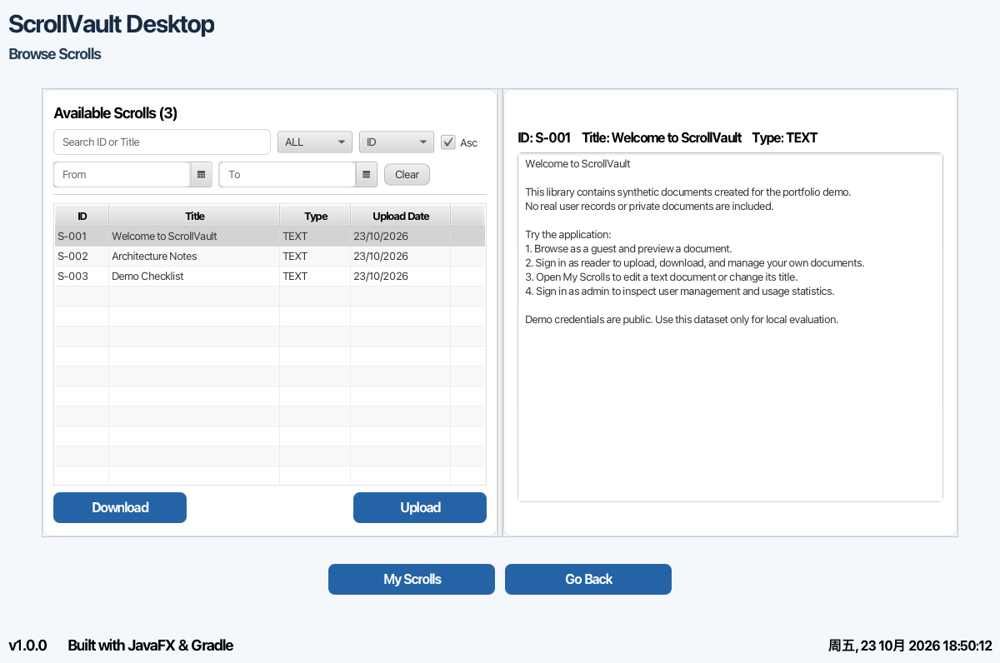
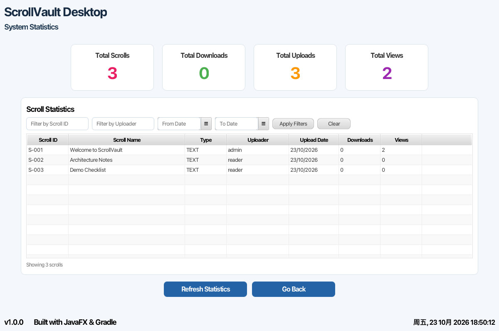
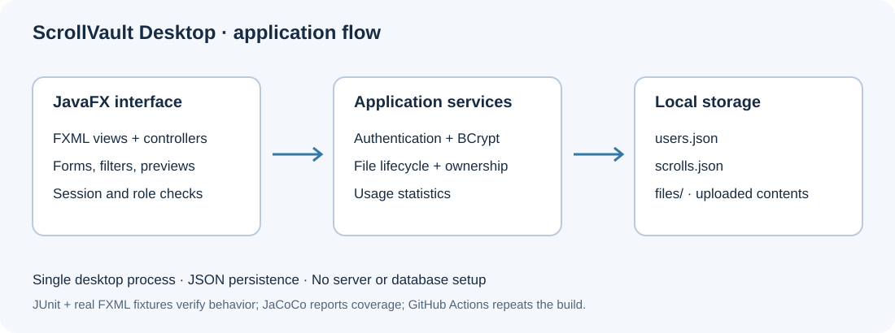

# ScrollVault Desktop

[](https://github.com/MakenzieAhern/scrollvault-desktop/actions/workflows/ci.yml)


**A JavaFX desktop library for uploading, finding, previewing, and managing documents and images.**

ScrollVault brings account management, owner-specific file operations, and administrator statistics into one local application. It uses JSON storage and a bundled Gradle wrapper, so you can explore the complete workflow without provisioning a database or server.

This portfolio edition grew from the Virtual Scroll Access System (VSAS), a university team project. It includes a fresh verification pass, fixes to persistence and authentication, isolated tests, synthetic demo data, and reproducible setup. [Authorship and project history](docs/PROVENANCE.md) are documented explicitly.



## What you can do

| Area | Implemented behavior |
| --- | --- |
| Accounts | Register, sign in, edit profile details, and change passwords. New passwords use salted BCrypt hashes. |
| Library | Upload `.txt`, `.png`, `.jpg`, and `.jpeg` files; search by title or ID; filter by type/date and sort records. |
| File operations | Preview text/images, download files, rename owned entries, edit owned text files, and delete owned entries. |
| Guest access | Browse, filter, and preview the library without registering. Downloads and mutations require sign-in. |
| Administration | Add/search/delete users, change roles, and inspect upload/view/download statistics. |
| Persistence | Store account records and metadata in JSON, with uploaded contents in a separate local files directory. |

“Scroll” is the original project's term for a library file. It remains in the UI and code. This is a **single-instance local desktop prototype**; its role controls do not provide a server or operating-system security boundary.

## Quick start

Install a **JDK 17** and make sure `JAVA_HOME` and `java -version` point to it. The included **Gradle 7.4.2** wrapper downloads Gradle and Maven dependencies on first use. A desktop display is needed to run the app.

```bash
git clone https://github.com/MakenzieAhern/scrollvault-desktop.git
cd scrollvault-desktop
./gradlew seedDemo
./gradlew run
```

On Windows, use `gradlew.bat seedDemo` and `gradlew.bat run` instead.

`seedDemo` creates two synthetic accounts and three text documents. It **refuses to overwrite a nonempty data directory**. You can also start with `./gradlew run` and register a regular account in an empty library.

| Demo role | Username | Password |
| --- | --- | --- |
| Administrator | `admin` | `admin123` |
| General user | `reader` | `reader123` |

These credentials are public and intended for local demonstration. The repository contains no real user database. All generated runtime data is excluded from Git.

To use a separate dataset, pass the same directory to both commands:

```bash
./gradlew -Dscrollvault.dataDir=/absolute/path/to/demo seedDemo
./gradlew -Dscrollvault.dataDir=/absolute/path/to/demo run
```

### A five-minute walkthrough

1. Select **Get Started**, then enter as a guest. Search for “Architecture” and preview the matching text file.
2. Sign in as `reader`. Upload a text file, open **My Scrolls**, edit its title/content, and download it to verify the result.
3. Upload two files with the same filename from different folders. Both library entries retain independent contents.
4. Sign in as `admin`. Inspect user management and refresh the statistics page after previewing/downloading files.
5. Restart the application with the same data directory to confirm persistence.



## Architecture



- **FXML + controllers:** forms, navigation, table filters, role checks, and previews.
- **Services:** authentication, document operations, and aggregate statistics.
- **Persistence:** Gson-backed user records and document metadata; uploaded files receive unique storage names.
- **Session:** an in-process current user determines which actions the UI exposes.

```text
src/main/java/com/vsas/
  Launcher.java          Packaged application entry point
  App.java               JavaFX scene lifecycle
  DemoData.java          Non-destructive synthetic demo setup
  controllers/          UI behavior and access checks
  services/             Authentication, document operations, statistics
  models/               User, role, and scroll records
  storage/              User JSON persistence
  security/             In-memory session
  utils/                Password hashing and preferences
src/main/resources/     FXML screens and CSS
src/test/java/          Service, persistence, model, and JavaFX tests
docs/                   Verification notes and provenance
```

The internal `com.vsas` package is retained from the original project. The application does not require a web API, cloud account, or database service.

## Testing and packaging

```bash
./gradlew clean build
```

`build` runs JUnit tests, generates JaCoCo coverage, and creates application distributions. JavaFX tests need a display. On a Linux machine without one, use:

```bash
xvfb-run -a ./gradlew clean build --no-daemon
```

Reports are generated at:

- `build/reports/tests/test/index.html`
- `build/reports/jacoco/test/html/index.html`
- `build/distributions/scrollvault-desktop-1.0.0.zip`

The distribution contains launch scripts and dependencies; it still requires Java 17 and is built for the current JavaFX platform. The JAR alone is not a standalone executable. CI runs the suite on Ubuntu with a virtual display and uploads reports.

See [verification results and methodology](docs/VERIFICATION.md) for measured test counts, coverage, and the original false-positive test issue. Screenshots use real FXML scenes populated with synthetic demo data; regenerate them with:

```bash
./gradlew test --tests com.vsas.PortfolioScreenshotsTest -PcaptureScreenshots --rerun-tasks
```

## Engineering improvements in this edition

- JavaFX thread assertions now propagate back to JUnit; failures cannot silently produce a green result.
- Replaced exception-swallowing/reflection-only checks with assertions against real UI fixtures and isolated storage.
- Unique upload paths prevent two files with the same name from overwriting each other.
- Empty catalogues remain empty after restart, and malformed metadata is reported instead of replaced silently.
- User IDs remain stable across role changes, preserving file ownership.
- BCrypt password storage, with compatibility for legacy hashes and upgrade on successful login for passwords within BCrypt's 72-byte limit.
- Explicit UTF-8 compilation, executable wrapper, runtime-data isolation, and Linux CI.

## Contribution and provenance

**Yuchen Deng** contributed the initial authentication and registration implementation, user models/persistence, BCrypt password handling, and animated login interface in the original project. This is supported by source commit `6753f1b`; commit counts are not a measure of total contribution.

Original team: **Aditya Bahl, Nicholas Huang Hong Shee, Yuchen Deng, and Lanfei Yan**. The portfolio migration, testing, documentation, and subsequent fixes are recorded separately in this repository. See [provenance](docs/PROVENANCE.md) for the source URL, exact snapshot, and publication cleanup.

## Scope and limitations

- JSON storage is designed for one application instance. There is no cross-process locking or transactional database.
- Files and contact details are stored locally without encryption at rest. Anyone with access to the data directory can read or alter them.
- Statistics are counters, not an immutable event log. Summary cards show global totals; table filters do not change those totals.
- The UI supports text and common image uploads. A legacy PDF filter does not imply PDF rendering or upload support.
- Language preferences do not translate the interface. Password recovery and multi-factor authentication are not implemented.
- Tests cover application behavior and FXML loading; native file chooser workflows and every OS/display configuration are not fully automated.

No open-source license was supplied with the original project, and this edition does not introduce one on behalf of all contributors. Attribution is retained; see [provenance](docs/PROVENANCE.md).
